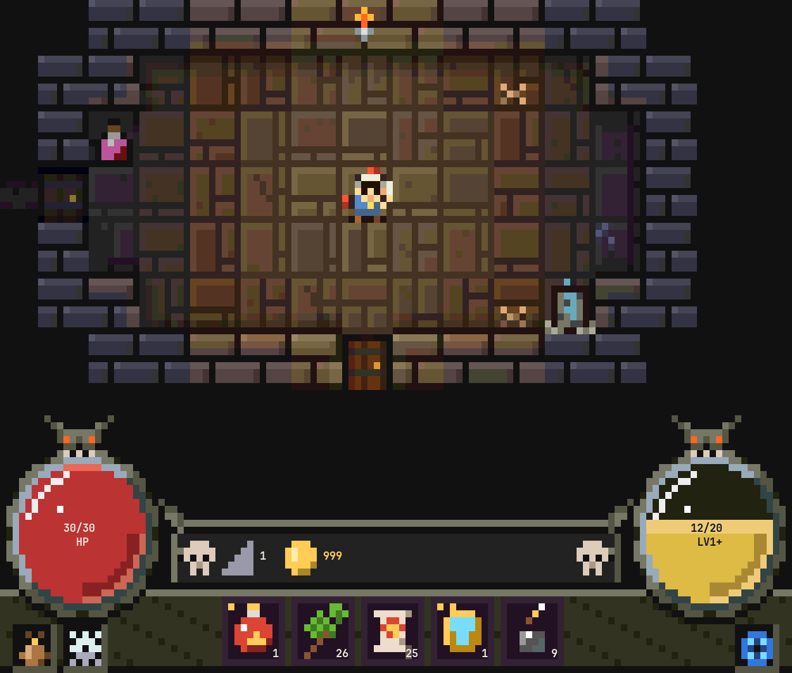
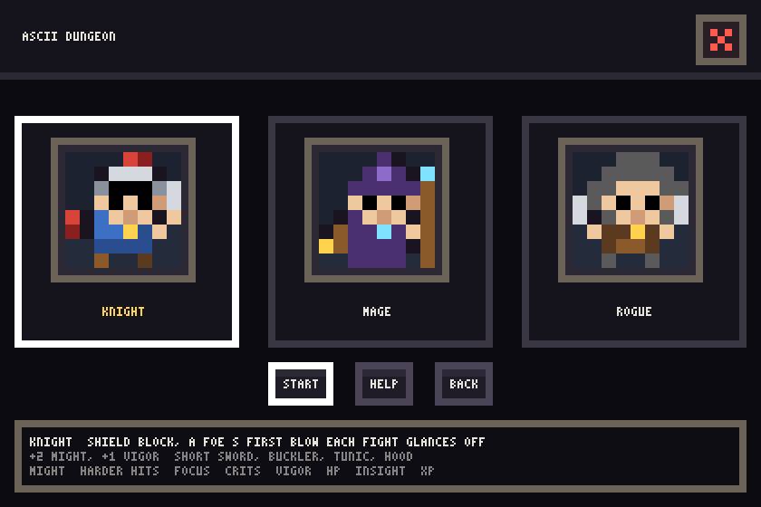
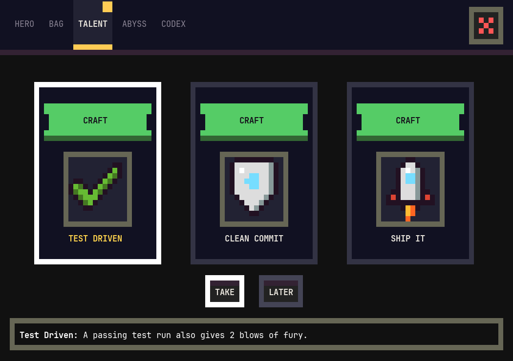
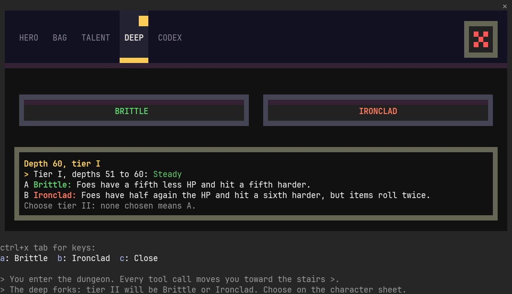
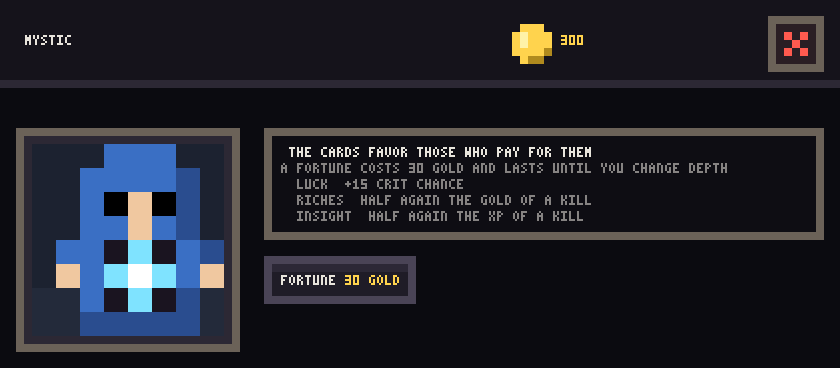
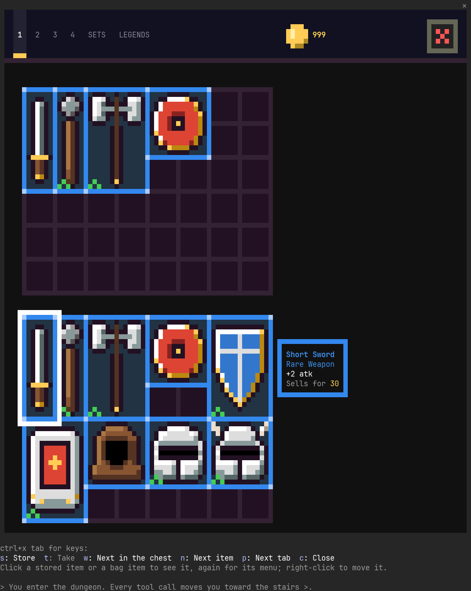
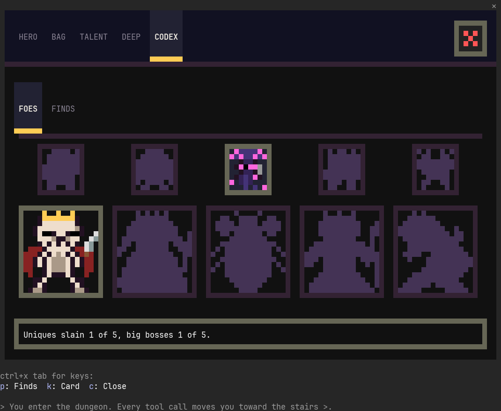

# ascii-dungeon

A Claude Code mod: a pixel roguelike in a pane, played by your coding session. Each tool call moves the hero, a failure
lets the foe hit back, and real work pays.



## What your coding does

| In the session | In the dungeon |
|---|---|
| Every tool call | A step or a blow |
| A failed call | The foe strikes |
| Tests that pass | A sure critical |
| A commit | A shrine and full HP |
| A push or a PR | A cache of loot |
| An answer finished | The stairs down, once the depth has seen 3 tool calls |

The same list is in the game, under How it plays. The hero follows the main session alone: a subagent's tool calls
play no part. To play by hand instead, set Play by hand in settings: the session then leaves the hero be, and foes
find them as they walk. What stays yours: the gear, the talents, and the standing orders in
settings (when to drink, when to throw smoke, what loot to leave). Through the portal is the town: a merchant, a smith,
a healer, a stash, an elder with quests, a mystic with fortunes, a villager with sealed packs and a guard who trades
three spare pieces for one better.

## Install

Requires a Claude Code with mods. Developed and tested on 2.1.309. The game is drawn for a dark Claude Code theme; on
a light theme some of its text is hard to read.

From the ilovepixelart marketplace, which pins each mod to its latest release:

```
/plugin marketplace add ilovepixelart/claude-code-mods
/plugin install ascii-dungeon@ilovepixelart
```

Or in one line, straight from this repository, following `main`:

```
/plugin install ascii-dungeon --marketplace ilovepixelart/ascii-dungeon-mod
```

To stay on one release, add this repository at its tag instead, then install from it:

```
/plugin marketplace add ilovepixelart/ascii-dungeon-mod#ascii-dungeon--v0.7.0
/plugin install ascii-dungeon@ascii-dungeon-mod
```

Run `/reload-plugins` (or start a new session) after installing. To take a new release later, run
`claude plugin update ascii-dungeon@ilovepixelart` in your shell, or `ascii-dungeon@ascii-dungeon-mod` if you installed
from this repository. Each [release](https://github.com/ilovepixelart/ascii-dungeon-mod/releases) also carries a zip of
the plugin for `claude --plugin-url`, with its SHA-256 beside it, and [CHANGELOG.md](CHANGELOG.md) lists what each one
changed.

To try it from a clone without installing: `claude --plugin-dir /path/to/ascii-dungeon-mod`.

## Playing

`/dungeon` opens the pane. The pixel view needs a terminal that draws truecolor half blocks, and the mouse needs the
fullscreen layout (`/tui fullscreen`).

| Pane | Shows |
|---|---|
| 105 columns or wider | the map, the strip and every window in pixels |
| 80 to 104 columns | the map and the strip in pixels, a compact inventory |
| narrower | the game as text |
| 62 rows or taller | every window whole with its keys; a shorter pane scrolls, and says by how much on its top row |

With the mouse: click the map to walk there (a foe, to charge it). On a pane of 105 columns or more the dash under
it has an HP orb and an XP orb (either opens the character sheet), the belt (a slot drinks), buttons in its corners for
the bag, settings and the portal to town, and a plaque of depth and gold over the map (the log); narrower, the strip's portrait opens the
inventory, the HP and XP bars the sheet, and the gear and the portal their own. Every window lists its keys under it, and `c` closes it.

As text, the keys are `i` inventory, `c` character, `a` attack, `p` potion, `w` explore, `d` descend, `t` portal,
`h` `j` `k` `l` to move, `z` zoom and `r` new game.

<table>
  <tr>
    <td></td>
    <td></td>
  </tr>
  <tr>
    <td></td>
    <td></td>
  </tr>
  <tr>
    <td></td>
    <td></td>
  </tr>
</table>

Options in the plugin's config: `sound` (effects) and `music` (the town's tune), both on by default.

## Working on it

| Command | Does |
|---|---|
| `node scripts/gates.mjs --typecheck` | every gate, in its order: release check, colors, font, strict validate, tests, ruff and the unit tests over the Python tools, typecheck (CI runs all but the typecheck, which needs the plugin opened once interactively) |
| `claude plugin test .` | every test |
| `claude plugin validate .` | what the engine would refuse |
| `bun tools/simulate.ts <out> --games 100 --steps 1000` | plays games through the rules, every invariant checked each step, and reports balance |
| `bun tools/feel.ts 100 1000` | danger, pace and variety per class: deaths and close calls per 100 tool calls, quiet stretches, foe kinds |
| `bun tools/curve.ts 6 15000` | the power curve, depth by depth: the hero's level, attack, defense, crit and max HP, hits a kill, the blow taken as a share of max HP and how many such blows the hero stands |
| `uv run --with pillow python tools/shots/shoot.py <out> [name...]` | every window as a real Claude Code session draws it: a copy of the mod in a private tmux, each scene of `tools/shots/scenes.ts` opened, captured cell for cell and painted as Ghostty shows it, into `<out>/gallery.html` |
| `bun tools/readme.ts` | the README's pictures, into `docs/img/` |
| `python3 tools/sounds.py` | builds the sound clips into `sounds/` and `hooks/clips.ts` |
| `python3 tools/measure.py` | frames as a real terminal receives them, during `/dungeon-bench` |

Rule changes go through the simulator; visual changes through a mockup round first (see `.claude/CLAUDE.md`).

## Docs

`docs/architecture.md` (how the pane plays), `docs/design.md` (the design language every pixel surface follows),
`docs/items.md` (classes, items, foes, loot), `docs/pacing.md` (what keeps a session varied, and the numbers),
`docs/town.md`, `docs/windows.md` (every pixel window), `docs/inventory.md`, `docs/dashboard.md` (the strip). Changes
by version: `CHANGELOG.md`.

## Versioning

Releases follow [Semantic Versioning](https://semver.org/). While the version is 0.x, any release may change
behaviour. The game is saved in a versioned layout (`SAVE_VERSION`): a release brings an older save up to its own, and
never reads or overwrites a save from a newer layout than it knows, and says so instead.

## License

MIT, see [LICENSE](LICENSE).
