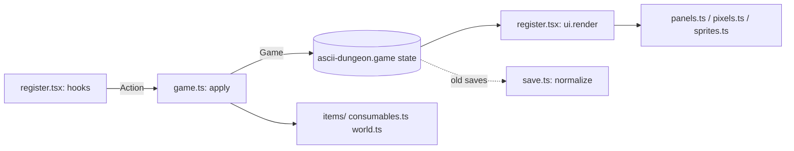

# Architecture

The game is a pure state machine; everything else draws it or feeds it.

- Clicks: `hooks/clicks.ts` is a Client drawn invisibly over the pixel map; it posts each left click, the hooks turn the cell into a tile with `clickToTile` (`pixels.ts`), and the game plays a `goto`. Pixel windows (the inventory) have their own click layer, `hooks/windowclient.ts`, which also draws their text boxes; each window decides what its gestures do, the bag in `hooks/bagui.ts` (see `windows.md`, `inventory.md`). Mouse reporting needs the fullscreen terminal.
- Motion: each action records the tiles it walked (`walked`); the pane plays them with `walkPosition` (`pixels.ts`), repainting the map in place with `$.ui.blit` on a timer, and drawing the current frame if it redraws mid-walk. Walks follow one rule: the drawn hero is the truth. Every action that walks, a click or a tool call's explore or charge alike (`act` in `register.tsx`), is planned with a dry run and played; the rules take it when the hero gets there, and with no map on screen at once. On the way everything reads the game as of the tile the drawn hero has reached (`walkState` in `pixels.ts`, from `alongTheWay` in `game.ts`, which replays the path a step at a time): the map, the strip, the log, a toast and a sound for what lies there, the arrival telling only what is left (`announce`). A new click, or a tool call that would move the hero, cuts a walk that is only a walk (`isOnlyAWalk`: its end is the same as walking its tiles) where he is drawn: the rules walk him exactly the tiles he has visibly walked (the `trail` action), nothing ahead is taken, and the new walk starts there. A walk that ends in more, a blow, a visit, the stairs, is not cut: a tool call carries it out, a click waits for it and goes once it is over (`interrupt`). Any other tool call happens alongside. The simulator checks the map against the strip on every tile of every walk, and every place a walk could be cut against what was drawn there (`drawnVsTold`, `cutVsDrawn` in `sim.ts`); the tests hold both at none. An unhurt hero passes the altar by.
- Frames: presentation is counted in frames, never in elapsed time. One ticker (`createTicker` in `frames.ts`) plays every animation: each tick of its `FRAME_MS` timer is the next frame of each, a late tick never skips ahead (motion slows under load but never lurches), a tick that comes while a frame is still drawing plays nothing, and the timer runs only while something animates. A new animation is a `Step` started on it by name. At 30 frames a second (`FRAME_MS` 33) a tile is `FRAMES_PER_TILE` (4) frames, so the hero moves exactly two pixels a frame; a speed must divide `PX` so no frame stands still or jumps. The hero walks in two poses held 2 frames each (`isStrideFrame`): stride on a tile's first two frames, the feet a pixel further apart (`strideOf`), stand on the last two. A blow the hero deals lunges them toward the struck tile by `LUNGE` (2, 2, then 1 px over the hit animation's first three frames), in the stride; the camera stays put. A crit holds the blow's first frame 3 frames more, a kill 4 (`hitFreeze`, `hitFramesFor`). Idle motion runs on a slow timer of its own (`ambientTick` in `register.tsx`, every 2 frames, painting only when a phase flips, waiting out walks and blows): 10 s after the last action the hero bobs a pixel up and down, 12 frames each way; in town the fountain's and the portal's two blues trade places every 10 frames (`townImage(true)` in `townpixels.ts`). Only these two need the timer, so it repaints a few times a second at most.
- Levels (`generate` in `map.ts`): rectangular rooms joined as a branching tree (each to the nearest one already joined, from a random first room), up to 2 loops (tunnels between rooms near on the map but over 1.5 times as far by walking), 1 to 3 dead-end branches off rooms; the hero starts in a random room and the stairs lie in the room farthest by walking. `analyze` measures a level as the hero walks it (distances, dead ends); `bun tools/levels.ts` reports the averages over many seeds. From a room the hero sees straight down each corridor leaving it (`CORRIDOR_SIGHT`). Some rooms take a shape, chosen by a hash of their place so the corridors are as they were (`shapeOf`, `shapeCut`): about 1 in 8 an L (one quarter cut back to rock), 1 in 40 a cross (corners cut) and 1 in 40 a pillared hall (a pillar row one in from each long wall), the cross and the hall only in rooms 7 by 5 or more. A shape never cuts a room's middle row or column, where corridors meet; a dead-end branch leaves only from room floor; themed rooms stay rectangular. Saves before version 6 re-enter their depth at the new start.
- Layouts (`layoutOf` in `map.ts`): depth 1 and boss depths are plain rooms as above; about half of other depths take another layout, the theme's favorite in two of five (crypt warrens, flooded halls caverns, forge hall). A hall: one great pillared hall, at least 18 by 7, about the middle, every other room tunnelled straight to it. A ring: rooms kept off a block of rock in the middle (`RING_CORE`) and joined round in the order of their angle about it; in about 5 levels in 6 no single corridor cell on the walk to the stairs cuts the hero off, where the other layouts nearly always have one. Warrens: up to 13 rooms of at most 6 by 4, more dead-end branches (about 4 a level, each a chest). Caverns: rooms of 6 by 5 or more get ragged walls (`raggedCut`: corners and about half the edge cells, never on or beside a middle row or column, and no edge cell left standing alone, so a wall holds no dead end), joined by tunnels that bend twice inside the box between their ends. `bun tools/layouts.ts` prints sample levels of each and their averages; `bun tools/layoutshots.ts <out>` renders one of each in pixels. Saves before version 8 standing on a depth whose layout changed re-enter it at the new start.
- Themes (`themeOf` in `map.ts`, which also picks each theme's themed rooms): five depths each, the crypt (as drawn), flooded halls (cool, green), the forge (red-black), then round again; a theme recolors the ground textures by channel weights (`themed`), the tiles' shapes and the light unchanged.
- Floor variety: about one slab in twenty is cracked (`isCracked`, `CRACK` in `pixelart.ts`); bones and rubble (`DECAL_ART`, `decalAt` in `pixels.ts`) lie on room floors by the walls, a chance of (rock beside the tile)^2 in 16, none in corridors. Both are fixed per tile and cost nothing per frame.
- Light (`pixels.ts`): the torch sits on the hero's tile and falls off smoothly (`torch` in `pixelart.ts`). Wall torches (`wallTorchesOf`) hang above about half the rooms that have a wall in the middle of their top side, each a warm pool from the foot of its wall (`wallTorchLight`, gone past 4 tiles); a shrine's braziers and an old forge's embers (`braziersOf` in `map.ts`) light the same pool from their own tile; the brightest light wins. The ground is lit through the torch's color, `torchColor`: cool at the edge of its reach, orange, a pale warm core; creatures and items are only dimmed, never below 70%. A wall takes the light of the floor beside it, never light through itself (`wallFaceLight`): full where it faces the hero, 55% where it faces away, the two pixels nearest an open side at that and the rest at 60%.
- Sound: each action carried out makes at most one effect, the biggest of what it came to (`soundFor` in `hooks/sounds.ts`: the portal either way, a level-up, a nemesis found, a beam of good loot, a chest, a peak's warning, a kill, a crit, a blow taken, the calm, a hit, gold), and a walk steps every other tile, two clips in turn (`stepAt`; each clip is a player process on the host, and one a tile measured a quarter of a core while walking). Effects share one channel, as old consoles kept theirs (`channel`): one ranked as high or higher cuts the effect still sounding, a lesser one is dropped while it sounds, so effects never pile up; the ranks run from the portal down to footsteps. In town the town's tune loops (`musicFor`, started on arrival and stopped on leaving). The mix is set by what comes out, each clip's peak times its gain (`MUSIC_GAIN`, `gainOf`): the tune lowest, under the footsteps, the footsteps under every other effect; the tune keeps to soft triangles in the middle register, the effects to noise and high pulses, so neither masks the other. A playing clip's level cannot change, so nothing ducks. `python3 tools/sounds.py` builds every clip into `sounds/` and writes their lengths and peaks to `hooks/clips.ts`; run it after changing a sound. The `sound` and `music` options in the plugin's config (both on by default) turn each off. The host plays clips with `afplay` on macOS; elsewhere nothing sounds.
- Frame cost: what is drawn is kept per game object, which is why games are never changed in place. `normalize` gives one output per input, `walkingGame` one game per tile, and `frameOf` keeps the lit world around the window (`worldLayer`) until the game, the torch's tile or the light changes, so most frames of a walk are a copy plus the hero. The walk holds its own game, replaced by each action, because reading the store hands back a fresh copy every time.
- Measuring: `/dungeon-bench` plays a fixed 40-tile walk on screen only (the rules never move) in a fixed scene, level `BENCH_SEED` with every tile explored, so runs compare whatever the save holds, and clears the measure; `/dungeon-frames` then reports the live ticker (gaps between ticks, late and skipped ticks, the time to draw a tick and how much of it the host takes the map, whole-pane redraws; p50, p99 and max). `python3 tools/measure.py` runs a real Claude Code with the mod in a pseudo-terminal that answers the host's queries as Ghostty does (so the host draws what it would there, images included), plays the bench and measures what the terminal receives: frames against ticks, the gaps between them, bytes a frame, CPU. It starts the session in the default permission mode and submits a command only once the menu lists it, so nothing reaches the model. `bun tools/bench.ts` times frame building alone, offline.
- Frame rate: 30 a second. The host sends only the cells that changed, a color escape (about 16 bytes) only where a cell's color differs from its left neighbour's, colors rounded to 16 levels a channel; that, not drawing, is the cost: it writes at most about 0.85 MB a second to the terminal, whatever it writes (an `Image` of raw pixels, 36 KB a frame, hit the same ceiling). Where little changes (the hero walking, dark ground scrolling) every frame gets through, about 1 KB each; at 60 a second the host dropped about every eighth. Scrolling 2 px a frame over lit, textured ground changed nearly every cell, and only 23 to 32 of 160 frames got through; so the camera (`tileCamera` in `pixels.ts`) moves only in whole tiles, while the hero still moves 2 px a frame. On the same walk 154 of 160 frames got through; the late few are the tile jumps. Those jumps, a full screen each, were then 87% of the walk's bytes, so the camera pages instead: past the dead zone and half a tile it jumps on a tile line ahead of the hero, leaving him half a zone behind the middle (a step back does not jump it back). The bench walk's bytes fell from 1,613 to 510 KiB, its jumps from 34 to 5 (`bun tools/frames.ts` replays the walk offline and splits the bytes between frames the camera moved and frames it held). `rasterCells` then draws a cell whose two pixels are within 8 on every channel (under half the host's rounding step) as a space on the bottom color, its unseen ink the left cell's, so the host writes neither a foreground nor the glyph's three bytes for it: 158 to 162 frames of 160, 2 to 3 late, 152 instead of 207 KiB a second.
- `hooks/register.tsx` is the only module that touches `$`. Hooks turn engine events (tool calls, prompts, turn ends, button presses) into `Action`s and draw the state. Keep it thin.
- `hooks/game.ts` holds `apply(game, action)`: pure, never mutates its input, every action a handler in `HANDLERS`; in town the handlers in `TOWN` come first. Combat, movement and leveling live here.
- `hooks/town.ts` is the town's map, who and what stands where, and walking there; `hooks/townpixels.ts` draws it once and keeps the picture (see `town.md`).
- `hooks/world.ts` creates a game (class, kit, stats) and arrives on levels. `hooks/map.ts` generates levels and paths.
- `hooks/items/` is the item system, one concern per module: `catalog.ts` (data), `loot.ts` (making items), `bag.ts` (the grid), `equipment.ts` (wearing), `trade.ts` (gold), `stats.ts`, `describe.ts`. `hooks/items.ts` re-exports them.
- `hooks/consumables.ts` is the belt and the effects consumables leave running.
- `hooks/save.ts` brings any older save up to `SAVE_VERSION`, one migration per version step.
- Drawing: `panels.ts` (text views and 1x map), `sprites.ts` (ASCII sprite view), `pixels.ts` (pixel frames and Raster cells), `pixelart.ts` (all pixel art, the single source the workbench renders too), `palette.ts`.

## Extending

| To add | Change |
|---|---|
| an item base, affix or Legendary | one entry in `items/catalog.ts`, plus its icon |
| a consumable | its kind in `types/index.d.ts` and one entry in `CONSUMABLES` |
| a monster | one entry in `BESTIARY` (`game.ts`), in a theme's `FAVORED` if it belongs there, and its art in `pixelart.ts` |
| a class | its kind in `types/index.d.ts`, its lean in `world.ts`, its kit in `items/catalog.ts` |
| a change to how hard the game is | the numbers in `hooks/balance.ts`, judged with `tools/simulate.ts` before and after |
| an action | its variant in `Action` and its handler in `HANDLERS` |
| a thing standing in town | one entry in `TOWN_DECOR` (`town.ts`) and its art in `TOWN_DECOR_ART` or `TOWN_BIG_ART` |
| a townsfolk | a spot in `TOWN_SPOTS` (`town.ts`), their art in `NPC_ART`, what a visit does in `visit` (`game.ts`) |
| a field in the saved state | the field in `types/index.d.ts`, its default in `newGame`, and a migration in `save.ts` with `SAVE_VERSION` raised |

- `hooks/invariants.ts` lists the rules every state keeps; `hooks/sim.ts` plays whole games through `apply` with a scripted coding session and checks them after every step. `tools/simulate.ts` runs it at scale and reports balance.

Art changes go through the mock workbench first; rule changes through the simulator (see `CLAUDE.md`).

## Frames and light

- A map frame the same as the one the terminal last got is not sent again (`sendMap` in `register.tsx`): a blow's number rises a pixel every other frame and its first frame is held, so about half a blow's frames repeat. The pane drawing the map itself resets what was last sent.
- In a room the hero's light stands at the room's middle (`frameOf` in `hooks/pixels.ts`): the room is lit as a whole and holds still while the hero crosses it. A torch moving with the hero re-lit about 1,100 cells of a big room each tile against 273 of a corridor, every one sent to the terminal; held still, a room frame changes about 47. In corridors the torch still moves with the hero, a tile at a time.
- `tools/measure.py` measures what reaches the terminal in a real session (`/dungeon-bench`); run it from a folder the session already trusts, and on a quiet machine: under load its tails measure the machine.
- Light comes in `LIGHT_STEPS` (8) levels, fixed for a whole tile (`lightOfTile`: the brighter of the hero's torch and a wall torch at the tile's middle), and each shaded color is snapped to the host's color grid (each channel a multiple of 17, the 16 levels a terminal cell is sent in) and kept in a table (`lightInt`). A torch step then changes only the tiles whose level changed, and a pixel whose shade rounds to the color it already had is not a changed cell: a corridor frame changes about 188 cells, where per-pixel light changed 273.
- The ground layer (`worldLayer` in `hooks/pixels.ts`) is kept between frames and, when the game, the torch or the window change, patched tile by tile: each tile has a key of everything its pixels are worked out from (`tileKey`: its surface, visibility, ground, occupant and art, its light, and for a wall with lit floor beside it the torch's place), and a tile whose key is unchanged keeps its pixels. On the bench walk that works out 151,000 pixels where drawing each layer afresh worked out 1,393,000 (200 by 44 cells; 178,000 against 2,756,000 at 260 by 70). Tests compare every patched frame of a walk and of a played game with the frame drawn afresh, pixel for pixel. `/dungeon-frames` reports map drawing with the layer kept and with it drawn again.
- What a level fixes is worked out once a level and kept, by cell: its surfaces (`surfaceOf`, whose door rules read many neighbours), its things (`floorThing`), each cell's rock sides and decal-painted floor (`cellOf`). A game's taken cells are read through a set, and art, kept as one array for each look or kind, is keyed by a number. Building the tile keys fell from 47% of the time a walk takes to draw to 21%.
- A walk's frames go to the host without waiting for it to take each (`sendLatest` in `register.tsx`): one blit in flight, a frame drawn meanwhile waiting in its place, a newer one replacing it. With the model's reply streaming beside the pane the host takes up to 78 ms a frame; waiting for it held every tick, the walk drawing a tick in up to 93 ms with a frame skipped, where it now takes 12 ms with none. A walk's end lets its last frame land before the pane draws the map. `tools/measure.py --chat <prompt>` measures the bench with a reply streaming.
- A frame's colors stay under the 1024 pairs the host's Raster paints exactly (about 360 in the dungeon, 500 in the town at 300 by 72; pinned by a test).
- Frame stamps: while `/dungeon-bench` walks, the map's first cell carries the frame's number in its color (`stampCells` in `hooks/pixels.ts`, the number mod 16 on the 17 grid, so the host's rounding keeps it). `tools/measure.py` reads the stamps back from the terminal's bytes and reports frames received, skipped, repeated and out of order, and the gaps and jitter between arrivals (`frame_report`, tested in `tools/test_measure.py`).
